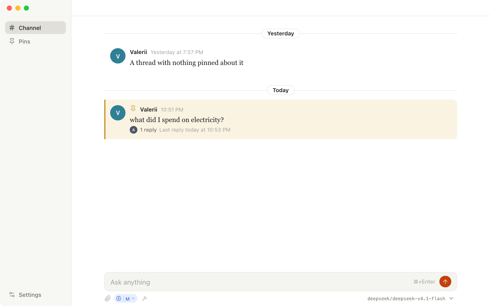
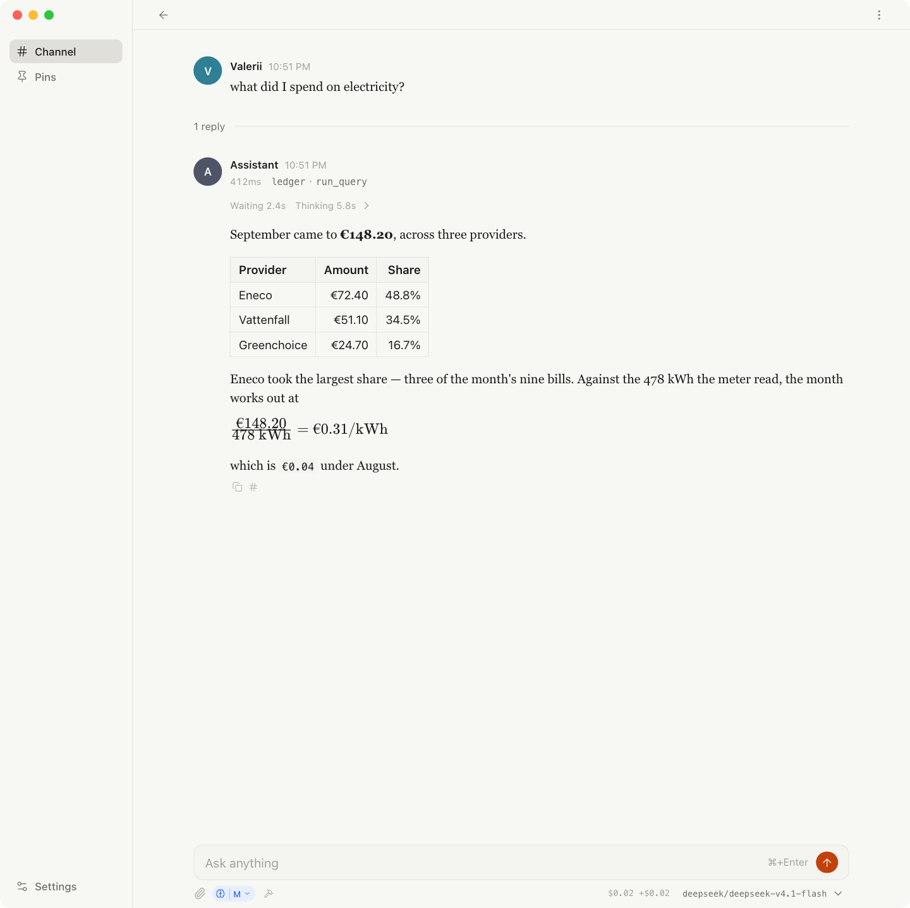
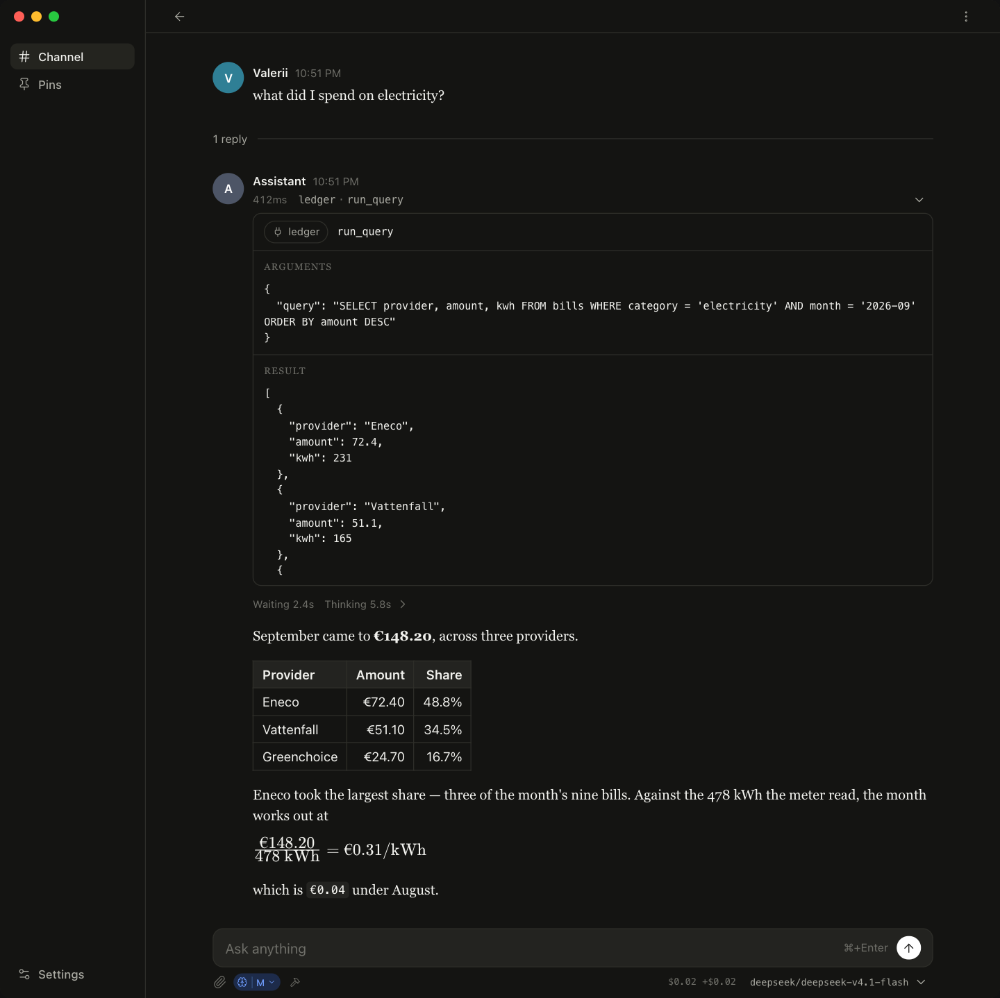
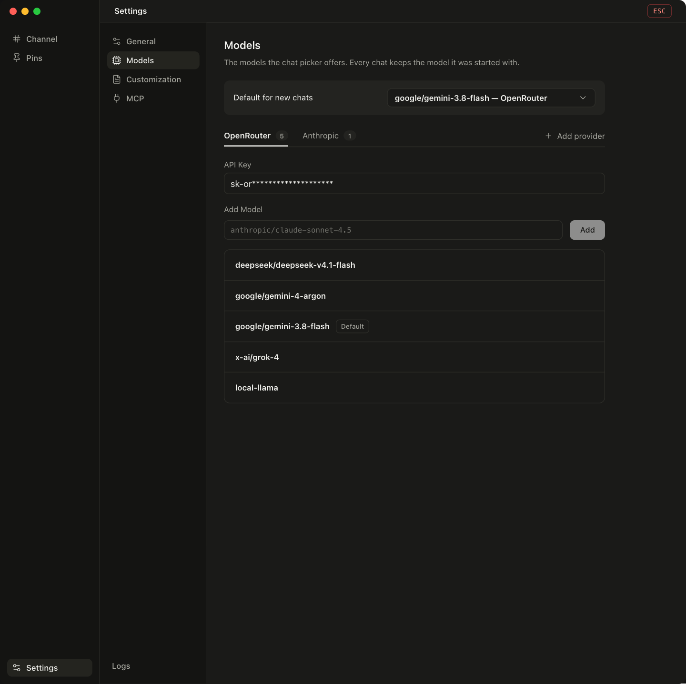
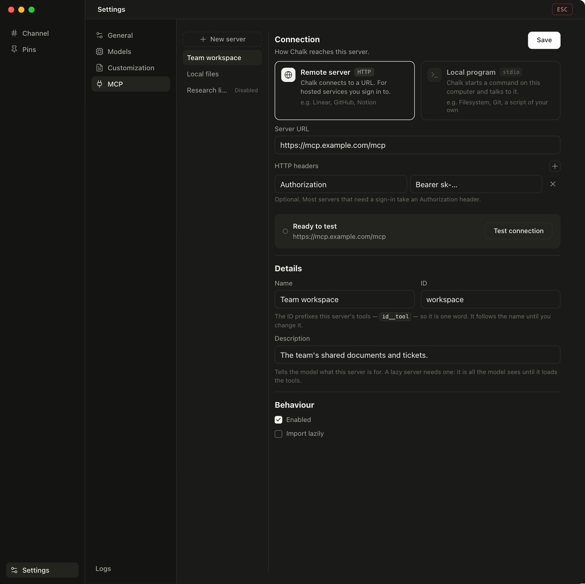
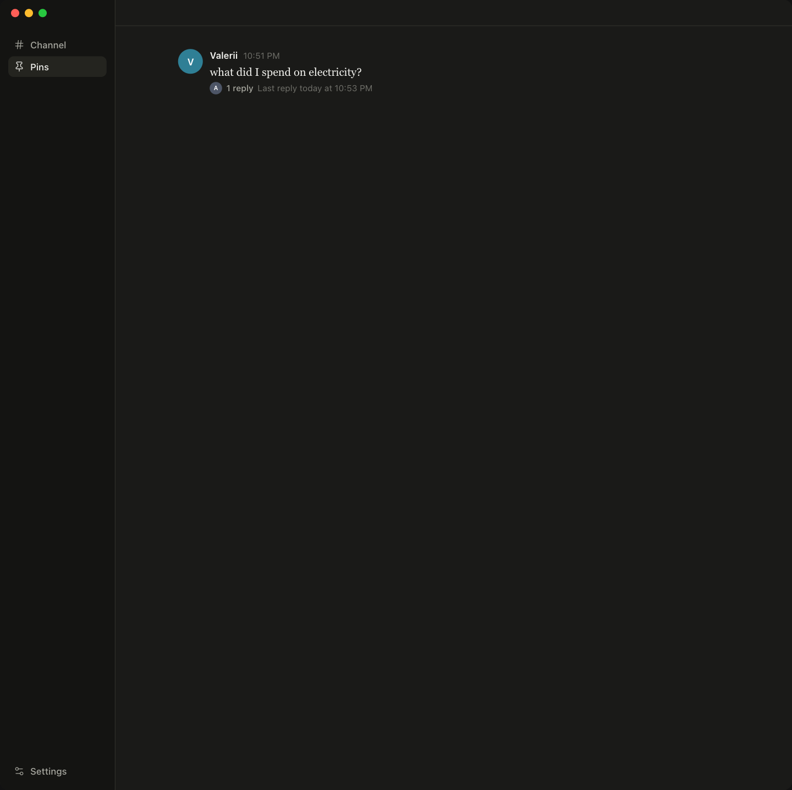
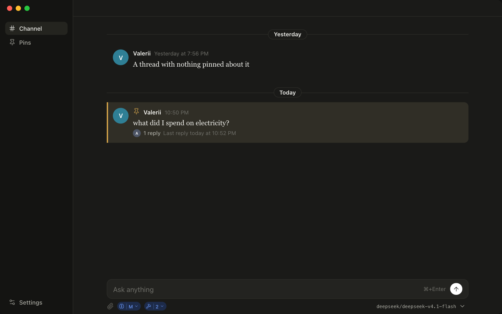
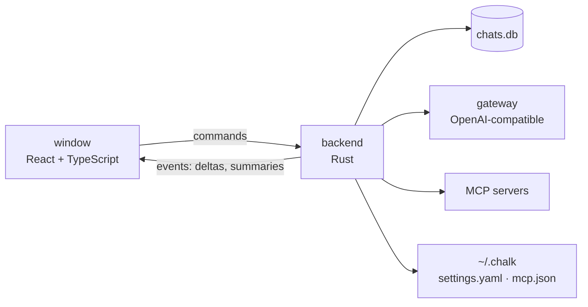

# Chalk

A desktop chat client for any OpenAI-compatible API: Tauri 2 (Rust) behind a React and TypeScript window. Frameless and rounded, a channel of threads, a serif reading column for the transcript, and a composer card that grows with the draft.



## What it does

- **Any gateway that speaks this API.** OpenRouter out of the box, any other endpoint you point it at, each with its own key, its own tab and its own list of models. A chat keeps the model it was started with.
- **Threads rather than a scrollback.** Every conversation is a row in the channel, read in stretches — today, yesterday, this week, this month, then by the month. A row pins to the top of the list, or is deleted after the button under the pointer asks.
- **Answers that read like documents.** Markdown with GFM tables, KaTeX math and highlighted code, parsed block by block as it streams — a settled block is never re-rendered.
- **Tool calls you can open.** Model context protocol servers are chosen per conversation, and each call is one row of the transcript that opens onto the arguments it carried and the result it got back. A server marked `lazy` is not offered to the model until it loads it by name; one marked `autoRun: false` stops its calls for you to allow.
- **Reasoning, off to high**, chosen beside the paperclip and sent as the gateways' unified `reasoning.effort`.
- **Images**, pasted or picked, scaled down and re-encoded before they go, drawn back in the transcript.
- **What it cost**: tokens in and out and the price, on the answer and in the composer's bar for the whole chat — with a response replayed from a gateway's cache saying so, and the prompt cache's own hit rate beside the tokens.
- **Runs that outlive the window.** A turn is driven by the backend rather than by the window, and the history is written as each message settles: switch chats, hide the window, or quit mid-answer, and what was said is kept.
- **The request itself**, as JSON: what the app is about to send — messages, tools and all — beside the transcript.
- **Light, dark, or the desktop's own answer**, and a Logs window with what the app and the webview have been saying.

## Screenshots

| A thread: a call, the turn's timings, and an answer with a table and a formula | The same call's card: the arguments it carried, the result it got |
| --- | --- |
|  |  |

| Models: the gateways, their keys, and the list the composer's picker offers | MCP: the servers this app may call, and how one is reached |
| --- | --- |
|  |  |

| Pinned threads, kept out of the feed | The channel in the other scheme |
| --- | --- |
|  |  |

The conversations in these are the app's own fixtures, driven through its harness with a mocked backend — no real chat is shown.

## Requirements

- Node.js, for npm
- A Rust stable toolchain
- macOS, Windows or Linux — the window is frameless and transparent, which on macOS uses Tauri's private API for the rounded corners (an App Store build would have to give that up)

## Run it

```sh
npm install
npm run tauri dev
```

Vite starts, the Rust backend compiles, and the window opens. With no key yet, open **Settings** (⌘,) and put one on the **Models** page — the app ships without one.

To build a bundle:

```sh
npm run tauri build
```

On macOS the signing identity is not optional — without it the bundle carries only the linker's ad-hoc signature and macOS reports it as damaged rather than as an app from an unidentified developer. [`skills/RELEASE.md`](skills/RELEASE.md) has the whole release.

## Where things are kept

| Kept where | What it holds |
| --- | --- |
| `~/.chalk/settings.yaml` | the gateways, their keys, the models, and the prompt. Written as you edit — there is no Save — in a `0600` file inside a `0700` directory. |
| `~/.chalk/mcp.json` | the model context protocol servers, each with how it is reached, whether it is enabled, and whether it is lazy or asks before running a call. |
| `chats.db` | the history: one row per chat, holding the whole transcript as JSON. It lives in the OS app-data directory — on macOS, `~/Library/Application Support/com.valerii.chat-ui/chats.db`. Delete it and the history starts over. |

## Keyboard

| Key | What it does |
| --- | --- |
| `⌘,` | Settings |
| `⌘J` | the request's JSON, with a thread open |
| `⌘+Enter` | send — `Enter` is a newline, so a prompt of several lines is something you can type |
| `Esc` | leave the settings or the JSON view, or go back to the channel; in the composer, give up a rewrite of an earlier prompt |

On Windows and Linux the modifier is `Ctrl`.

## Development

```sh
# Vite alone, the window's frontend
npm run dev

# types
npx tsc --noEmit

# tsc + vite build
npm run build

# the backend's tests
cargo test --manifest-path src-tauri/Cargo.toml
```

The backend's tests cover the store and its migrations, the run's state machine, the settings file and the MCP client. The window's behaviour is driven in the browser instead: [`harness.html`](harness.html) is a scratch page for the window's surfaces, with the Rust side mocked out at the boundary the app talks to. `?app` renders the whole window there, `?tab=<general|models|customization|mcp>` opens the settings section the scratch page draws, and a driver reaches the mock through `window.backend` to push a stream, commit a turn or fail one.

```
src/            the window: React components, the API layer, the styles
src-tauri/      the backend: commands, the store, runs, settings, MCP
docs/           the screenshots above
skills/         the release, end to end
AGENTS.md       what the code is and why — the design, in full
```

The front end is React on Vite with TypeScript; the answers are drawn by `react-markdown` with `remark-gfm`, KaTeX and `rehype-highlight`. The backend is Rust — Tauri 2, `reqwest` for both the chat and the protocol, `rmcp` for the MCP client, `rusqlite` with SQLite bundled, and `serde_norway` for the YAML the settings are written in.

## How it is put together



The window is a view over the backend's state: a turn is a run in Rust, which streams its answer, commits it as each message settles, and reports what it cost. That is what lets an answer keep arriving while you are reading another chat.

## The design

Everything above is the short version. [AGENTS.md](AGENTS.md) is the long one: what each surface is for, the invariants the backend holds, and the reasons behind the measures — written for whoever changes this code next.

No license is offered.
